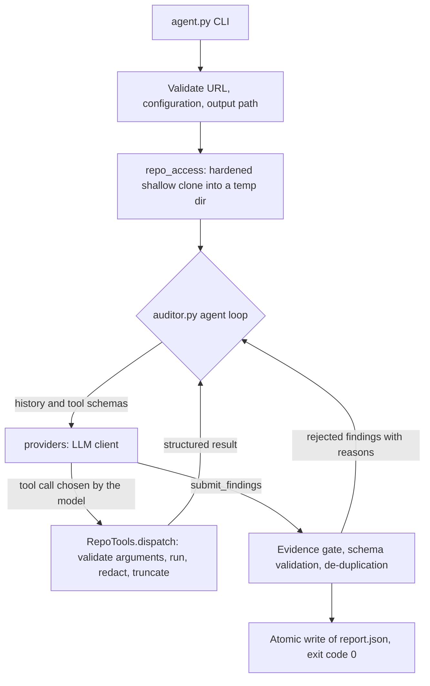

# DevOps Repository Auditor

An LLM-driven agent that inspects a public GitHub repository and reports DevOps defects (security, CI, dependencies, testing, configuration, hygiene, collaboration, build/release) as strict JSON.

**Assignment:** Assignment 2, "Build an AI Agent for DevOps Repository Auditing" (MLOps & Production AI Engineering).

```bash
python agent.py --repo https://github.com/OWNER/REPOSITORY --output report.json
```

## Quick start for the grader
```bash
python -m venv .venv
source .venv/bin/activate            # Windows Git Bash: source .venv/Scripts/activate
pip install -r requirements.txt
cp .env.example .env                 # then put ONE provider key in .env
python agent.py --repo https://github.com/OWNER/REPOSITORY --output report.json
```
No API key? The whole test suite still runs offline in a few seconds: `pip install -r requirements-dev.txt && python -m pytest -q`.

## Features
- A genuine agent loop written in plain Python (no LangChain, LangGraph, AutoGen, CrewAI or n8n). The LLM chooses every tool call.
- Four read-only inspection tools: `list_files`, `read_file`, `search_code`, `git_log`.
- Evidence gate: a finding is accepted only if the agent actually read the file and line it cites.
- Strict JSON report with exactly the eight required fields per violation.
- Secret redaction everywhere (tool output, trace, report, errors).
- Hard limits on iterations, tool calls, time, output size and repository size.
- Several LLM providers behind one interface (hosted or a local Ollama model).

## Architecture and agent cycle
Observe -> Reason -> Select tool -> Execute tool -> Interpret result -> Continue -> Report.



### Dynamic tool selection
The Python code never decides which inspection to run. It sends the model a short first observation (repository URL and top-level entries) plus the tool schemas. The model replies with a tool call, the code validates and executes it, and the result goes back to the model, which decides what to do next: read a file it found, search for a pattern, check history, or submit. The system prompt describes goals and rules for what counts as a defect, never a procedure. Offline tests use a scripted model and prove that the executed tool sequence always equals what the model asked for, and that follow-up calls depend on earlier results.

The harness adds only guard rails that never choose tools for the model:
- **Evidence gate:** findings about files or lines the agent never saw are rejected, with feedback the model can act on.
- **Absence checks:** `file=null` is allowed only for absence rules (for example no tests, no README), and an absence claim that the agent's own file listing contradicts is rejected.
- **One-time reminder:** if the model tries to finish while workflow, dependency, Docker or configuration files that it listed are still unopened, it receives one reminder naming them. The model decides whether to read them.
- **Limits and loop protection:** maximum iterations, tool calls and wall-clock time; duplicate identical calls are refused; an unproductive streak forces a final submission.

## Project structure
| File | Purpose |
|---|---|
| `agent.py` | CLI entry point, report writing, exit codes |
| `auditor.py` | The agent loop, evidence gate, limits |
| `tools.py` | The four inspection tools and their schemas |
| `llm_client.py` | Anthropic client |
| `openai_client.py` | Client for OpenAI-compatible APIs (Gemini, Groq, Mistral, OpenRouter, Ollama) |
| `providers.py` | Chooses the provider from environment variables |
| `schemas.py` | Violation model, rule catalog, de-duplication, `submit_findings` schema |
| `prompts.py` | System prompt |
| `repo_access.py` | URL validation and hardened clone |
| `redact.py` | Secret redaction |
| `config.py` | Tool and repository limits |
| `evaluate.py`, `tests/fixture_repos.py` | Precision/recall/F1 on synthetic labelled fixtures |
| `check_llm.py` | Four-request diagnostic for your LLM provider |
| `tests/` | Offline test suite |
| `sample_report.json` | A real report produced by the command above |

## Prerequisites and installation
Python 3.10 or newer (developed on 3.12) and `git` on PATH.
```bash
python -m venv .venv
source .venv/bin/activate            # Windows Git Bash: source .venv/Scripts/activate
pip install -r requirements.txt       # runtime
pip install -r requirements-dev.txt   # adds pytest and ruff
```

## LLM provider and API key
Copy `.env.example` to `.env` and set the key for **one** provider. `.env` is git-ignored; never commit it. If `AUDITOR_PROVIDER` is not set, the provider is detected from whichever key is present.

| Provider | Variables | Default model |
|---|---|---|
| Anthropic | `ANTHROPIC_API_KEY` | `claude-sonnet-5-5` |
| Gemini | `GEMINI_API_KEY` | `gemini-3.5-flash-lite` |
| Groq | `GROQ_API_KEY` | `openai/gpt-oss-120b` |
| Mistral | `MISTRAL_API_KEY` | `mistral-small-latest` |
| OpenRouter | `OPENROUTER_API_KEY` | `openai/gpt-oss-120b:free` |
| Local (Ollama or any OpenAI-compatible server) | `AUDITOR_PROVIDER=openai_compatible`, `AUDITOR_BASE_URL`, `AUDITOR_API_KEY`, `AUDITOR_MODEL` | none |

`AUDITOR_MODEL` overrides the model for any provider. **Honesty note:** the author could only exercise the local Ollama path (`qwen2.5:7b`) against a live model. The other providers are implemented against their documented OpenAI-style or Anthropic APIs and tested offline with mocks. Run `python check_llm.py` to verify yours before a full audit; it makes four tiny requests and reports exactly what works.

Free hosted tiers have small limits and some regions are blocked. The client paces requests (`AUDITOR_MIN_INTERVAL_S`) and retries on rate limits.

## Usage
```bash
python agent.py --repo https://github.com/octocat/Hello-World --output report.json
python agent.py --repo https://github.com/OWNER/REPO --output report.json --verbose   # print the investigation trace
```
Exit codes: `0` audit completed and report written; `1` audit could not be completed (clone, API or agent failure; no report is written); `2` bad usage or configuration (checked before any clone or API call); `3` unexpected internal error; `130` interrupted. The program never asks questions.

## The JSON report
```json
{
  "repository": "https://github.com/example/demo-project",
  "violations": [
    {
      "rule_id": "SEC-001",
      "category": "security",
      "severity": "critical",
      "file": "config.py",
      "line": 17,
      "description": "Hardcoded API credential",
      "evidence": "Credential assigned directly in source code",
      "recommendation": "Use a secrets manager or environment variable"
    }
  ]
}
```
- Exactly these eight fields; no extras. `severity` is `critical`, `high`, `medium` or `low`.
- `file` and `line` are `null` for absences (for example "no tests"); the line is 1-based as shown by `read_file`.
- Categories and rule prefixes: security `SEC`, ci `CI`, dependencies `DEP`, testing `TST`, code_quality `QUA`, configuration `CFG`, repository_hygiene `HYG`, collaboration `COL`, build_release `BLD`. A rule id's prefix must match its category.
- Duplicates are removed, output is sorted by severity then location, and the file is written atomically.
- An empty `violations` list means the inspection completed and found nothing defensible. A failed inspection exits non-zero and writes no report.

## Inspection tools
| Tool | Parameters | Returns | Safety |
|---|---|---|---|
| `list_files` | `path`, `max_depth` | counts, notable files (workflows, manifests, config, docs, tests), capped file list | skips (but reports) `node_modules`, `dist`, `.git` and similar; does not follow symlinks; count and depth caps |
| `read_file` | `path`, `start_line`, `max_lines` | numbered, redacted lines | rejects `..`, absolute paths, `.git`, symlinks leaving the repo, binary and oversized files (256 KB) |
| `search_code` | `pattern`, `path_glob`, `case_insensitive`, `max_results` | redacted matches labelled as leads, not proof | rejects risky regexes, caps results and time, skips binary and large files |
| `git_log` | `max_count`, `path` | short hash, author, date, subject | credentials stripped from remote URL; handles missing history; shallow-clone aware |

All tools return structured JSON and never raise into the loop. `run_pytest` and `run_ruff` are **intentionally not implemented**: repository code is never executed.

## Safety and read-only guarantee
- The target repository is never modified: the clone lives in a temporary directory that is deleted afterwards, every tool only reads, and nothing is pushed, branched or changed on GitHub.
- Clone hardening: only `https://github.com/OWNER/REPO` URLs are accepted; hooks, symlink checkout, submodules, credential helpers and prompts are disabled; the clone is shallow, time-limited and size-checked; API keys and tokens are stripped from git's environment.
- Repository content is treated as untrusted data. The system prompt says so, the model can only call four registered tools with validated arguments, and nothing from the repository is ever executed.
- Secrets are redacted from tool output, trace, report and error messages.
- Residual risks: a vulnerability in git itself; regex backtracking is mitigated by heuristics and deadlines but Python cannot interrupt a running match; prompt injection can still influence which findings the model reports (not what it is allowed to do); redaction is heuristic and deliberately over-cautious; snippets of the repository are sent to the LLM provider, so audit only repositories you are happy to share with it.

## Testing
- Offline (no key, no internet), about 300 tests: `python -m pytest -q`. Covers tools (traversal, symlinks, binary and large files, redaction, git), the agent loop with a scripted model (dynamic selection, follow-ups, invalid calls, malformed responses, limits, repeated calls, API errors), the report contract and exit codes, providers and the evaluation scoring. GitHub Actions runs them on every push.
- Needs an LLM: `python check_llm.py` (provider diagnostic), `python evaluate.py` (fixtures), and a real audit with the command above.

## Evaluation methodology and results
`python evaluate.py` runs the real agent over 10 synthetic repositories in `tests/fixture_repos.py`: a hardcoded secret, `write-all` workflow permissions, a CI test step that cannot fail, tests never run in CI, a machine-specific path, a mixed repository with four defects, a README prompt injection, and three that should produce **no** findings (healthy, acceptable alternative tooling, suspicious-looking but fine). Findings are matched one-to-one to labels by file, category and line (tolerance 5); precision, recall and F1 are micro-averaged. `python evaluate.py --verbose` prints each investigation.

**These labels were written by the project author. They measure local behaviour only and say nothing certain about any hidden test set.**

First full run, local `qwen2.5:7b` on a CPU (a small model; before the stricter evidence gates were added):

| Fixture | Expected | TP | FP | FN |
|---|---|---|---|---|
| hardcoded_secret | 1 | 1 | 0 | 0 |
| machine_specific_path | 1 | 1 | 0 | 0 |
| mixed_defects | 4 | 1 | 0 | 3 |
| injection_in_readme | 1 | 0 | 0 | 1 |
| workflow_write_all | 1 | 0 | 2 | 1 |
| ci_tests_swallowed | 1 | 0 | 1 | 1 |
| ci_no_test_step | 1 | 0 | 1 | 1 |
| healthy | 0 | 0 | 0 | 0 |
| suspicious_but_fine | 0 | 0 | 1 | 0 |
| acceptable_alternatives | 0 | 0 | 1 | 0 |
| **Total** | 10 | 3 | 6 | 7 |

Precision 0.33, recall 0.30, F1 0.32. Afterwards, `file=null` was restricted to absence rules, absence claims are checked against the file listing, and the one-time reminder and prompt changes were added. Only a partial rerun of two fixtures was done after that (0 of 5 expected defects found; the rejected submissions were being investigated), so **no post-change full-suite score is claimed**. A larger hosted model is expected to do better, but that has not been measured.

## Known limitations
- Detection quality depends strongly on the model. The only live-tested model is a small local one, and its scores are weak.
- It cannot see GitHub settings (branch protection, required reviews, Actions run history), so it never claims anything about them.
- It does not run tests or linters; findings come from reading files.
- Shallow clone (depth 50): history questions are limited. Very large repositories hit the size and tool-call limits and the report may be partial (a warning is printed).
- Results vary from run to run because the model is not deterministic.

## Troubleshooting
- `No LLM API key found`: put a key in `.env` (see the provider table).
- 403 "project has been denied access" or `signup_blocked`: the provider blocked your account or region; use another provider or a local model.
- Rate limited or quota exhausted: wait, raise `AUDITOR_MIN_INTERVAL_S`, or switch provider.
- Ollama: run `ollama serve` with `OLLAMA_CONTEXT_LENGTH=16384` (smaller windows silently cut the instructions) and `OLLAMA_KEEP_ALIVE=60m`; a CPU-only audit can take 10 to 40 minutes. Settings that worked: `AUDITOR_PROVIDER=openai_compatible`, `AUDITOR_BASE_URL=http://localhost:11434/v1`, `AUDITOR_API_KEY=ollama`, `AUDITOR_MODEL=qwen2.5:7b`, `AUDITOR_LLM_TIMEOUT_S=900`, `AUDITOR_WALL_CLOCK_S=5400`.
- No output for minutes: use `python -u agent.py ... --verbose` to see each step.
- Python tests fail with import errors: activate the virtual environment first.

## Does it modify target repositories?
No. It clones a temporary read-only snapshot of a public repository, reads it, and deletes the snapshot. It never pushes, opens pull requests, or changes any GitHub setting.